# MyBestSim : tableau de bord du catalogue eSIM

Réponse au test de recrutement « Stagiaire Développeur IA & Automatisation » de MyBestSim.
Le projet lit les fichiers CSV des fournisseurs eSIM et en tire un tableau de bord en ligne.
Il ajoute un service qui importe les fichiers du jour sans reconstruire le site.

- **Dashboard en ligne** : <https://mybestsim.sbonneau.xyz>
- **Article SEO (partie 2)** : <https://mybestsim.sbonneau.xyz/blog/internet-croisiere-esim/>
- **Code** : ce dépôt
- **PageSpeed Insights** : 100 en performance, accessibilité, bonnes pratiques et SEO, sur mobile
  ([détail](#performance-pagespeed-insights))

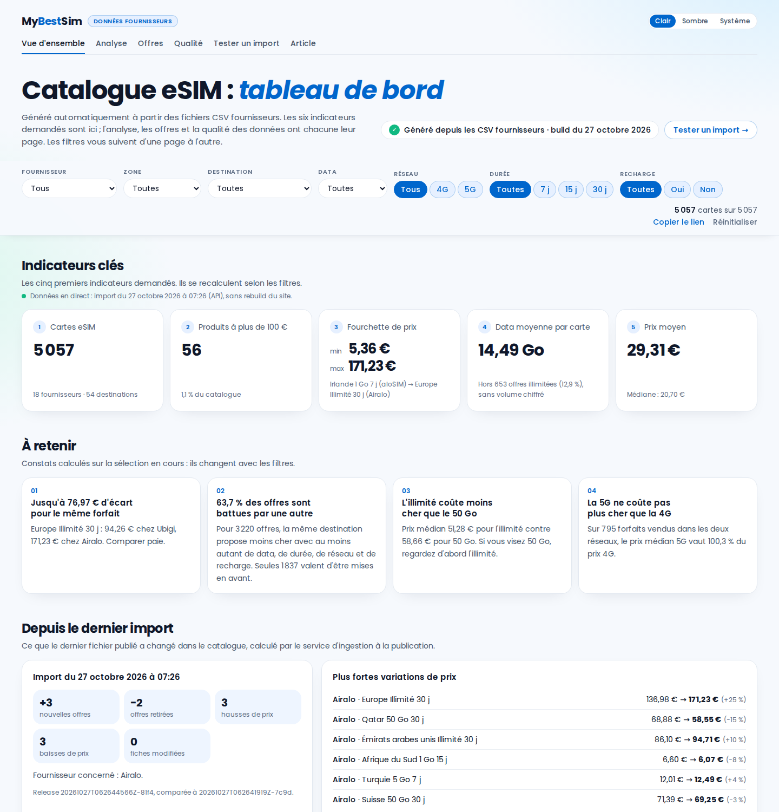

## Sommaire

- [Ce que demande le sujet, et où le trouver](#ce-que-demande-le-sujet-et-où-le-trouver)
- [Les pages](#les-pages)
- [Au-delà du sujet](#au-delà-du-sujet)
- [Architecture](#architecture)
- [Ajouter des données sans rebuild](#ajouter-des-données-sans-rebuild)
- [Choix assumés](#choix-assumés)
- [Ce que disent les données](#ce-que-disent-les-données)
- [Partie 2 : l'article SEO](#partie-2--larticle-seo)
- [Qualité et tests](#qualité-et-tests)
- [CI/CD](#cicd)
- [Lancer le projet](#lancer-le-projet)
- [Structure du dépôt](#structure-du-dépôt)
- [Comment j'ai utilisé l'IA](#comment-jai-utilisé-lia)
- [Limites et suite](#limites-et-suite)

## Ce que demande le sujet, et où le trouver

| Point du sujet | Valeur | Où |
| --- | --- | --- |
| 1. Nombre total de cartes eSIM | 5 056 | accueil, carte 1 |
| 2. Produits à plus de 100 € | 56 | accueil, carte 2 |
| 3. Fourchette de prix | 5,36 € à 154,63 € | accueil, carte 3 |
| 4. Data moyenne par carte | 14,49 Go (hors 653 offres illimitées) | accueil, carte 4 |
| 5. Prix moyen global | 29,30 € (médiane 20,70 €) | accueil, carte 5 |
| 6. Répartition par fournisseur | 18 fournisseurs, d'Airalo (722) à 4S eSIM (92) | accueil, carte 6 et section 6 |
| 7. Statistiques bonus | prix au Go, paliers, distribution, économies, opportunités, qualité | `/analyse`, `/qualite` |

Les six points tiennent dans le premier écran de l'accueil, sur un téléphone (390 × 844) comme sur un
portable (1 440 × 900). Ils sont dans le HTML généré au build : la page les affiche avant même que le
JavaScript se charge. Chaque chiffre porte `data-kpi` et `data-value`, pour qu'un programme
puisse le vérifier sans interpréter du texte. Tous ces chiffres ont été mesurés une seconde fois
par un script indépendant, voir [Qualité et tests](#qualité-et-tests).

## Les pages

| Page | Contenu |
| --- | --- |
| `/` Accueil | points 1 à 6 dès le premier écran, répartition par fournisseur avec leurs logos, histogramme des prix avec le seuil de 100 €, trois constats « À retenir », dernier import, accès aux autres pages |
| `/analyse` | point 7 : prix médian au Go, prix par palier, histogramme, profil des offres, couverture, meilleures offres, économies, opportunités pour MyBestSim |
| `/offres` | toutes les offres (tri, recherche sans accents, export CSV) et simulateur de voyage |
| `/qualite` | contrôle des imports, contrôles métier, choix assumés |
| `/import` | aperçu d'un fichier fournisseur, puis publication dans le bac à sable (sans jeton) ou dans le catalogue (avec jeton) |
| `/blog/internet-croisiere-esim/` | partie 2 : l'article SEO « Internet en croisière : quelle eSIM choisir ? » |

Les filtres (fournisseur, zone, destination, data, réseau, durée, recharge) vivent dans l'URL : un
lien partagé rouvre la même vue, et la sélection suit le visiteur d'une page à l'autre. Avec
`?bac=1`, chaque page montre les données du bac à sable.

| Analyse | Offres et simulateur |
| --- | --- |
| 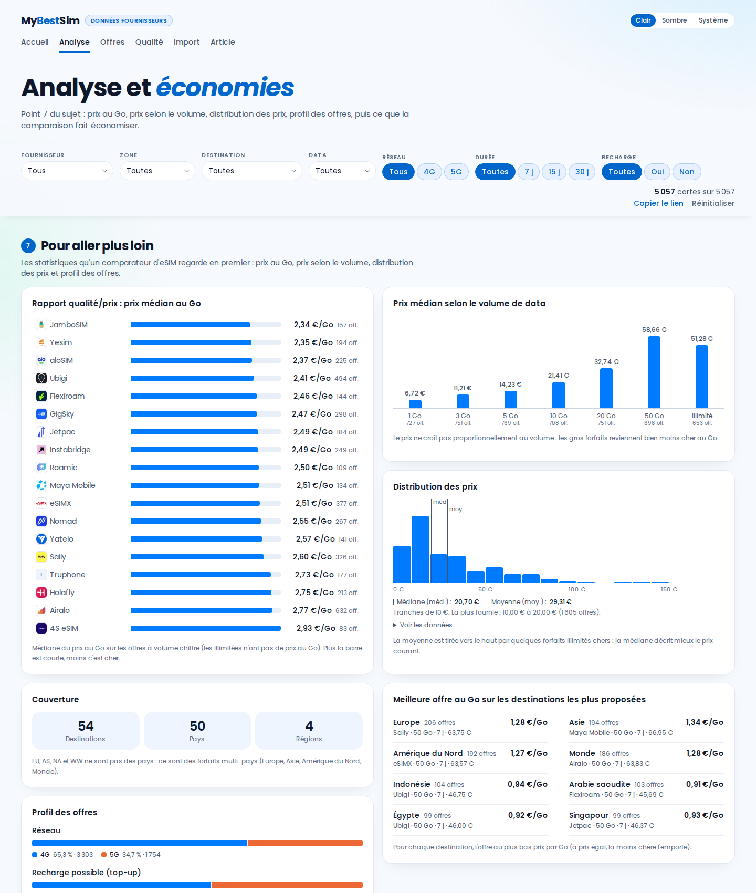 | 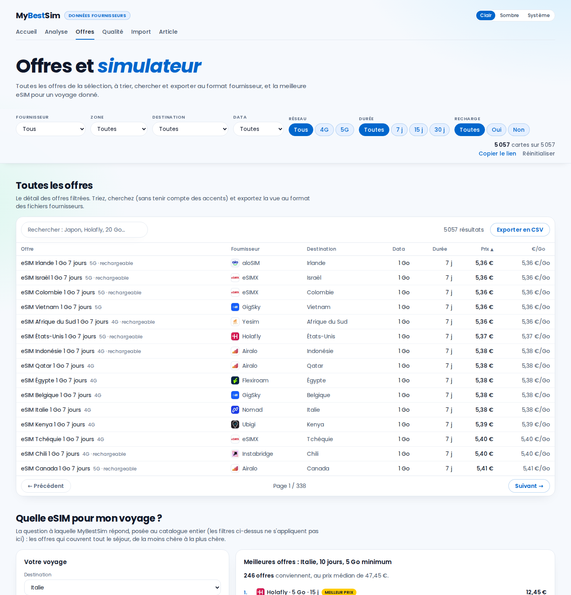 |

| Qualité | Mobile | Thème sombre |
| --- | --- | --- |
| 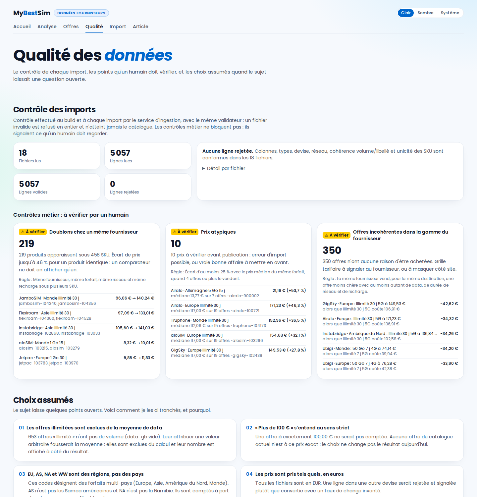 | 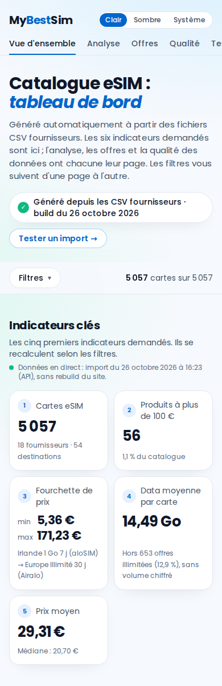 | 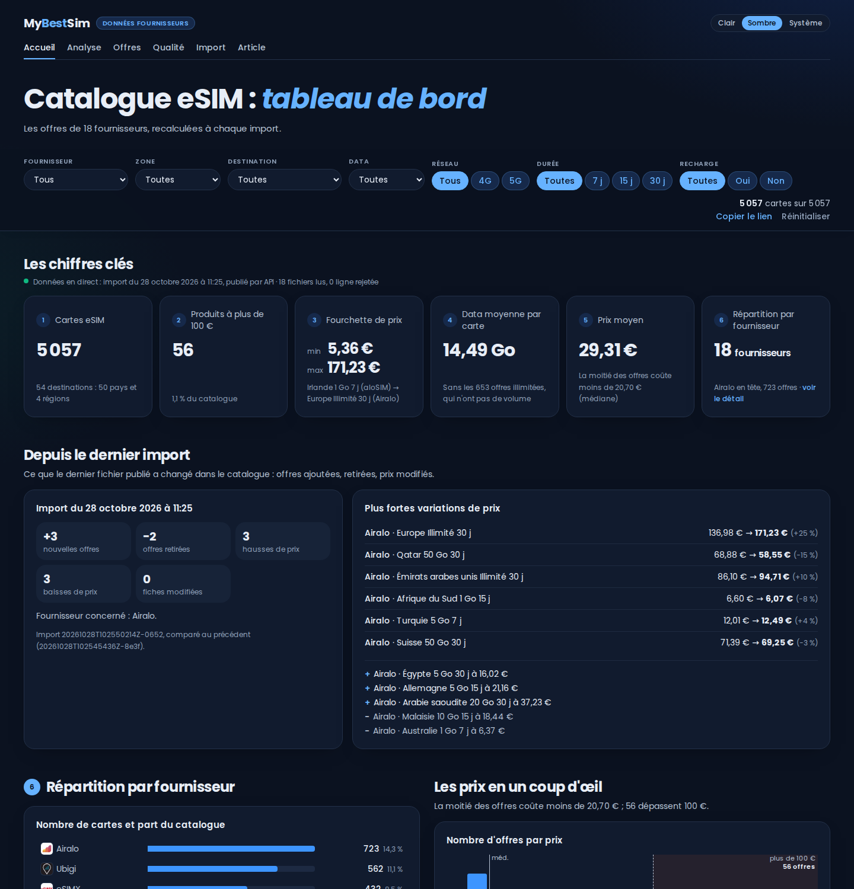 |

Les captures sont prises sur un serveur neuf, juste après la publication du fichier d'exemple
(`bun run screenshots`) : le catalogue y compte donc 5 057 offres, et l'accueil montre l'encart
« Depuis le dernier import ».

## Au-delà du sujet

- **Un accueil qui se lit d'un coup d'œil.** Le sujet décrit un outil pour l'équipe qui importe les
  fichiers chaque jour : l'accueil montre d'abord les six points, puis l'état du dernier import
  (fichiers lus, lignes rejetées), un histogramme des prix où les offres à plus de 100 € sont
  comptées, et trois constats. Le reste vit sur les autres pages. Chaque colonne de l'histogramme
  donne son nombre d'offres au survol, d'un tap sur téléphone ou au clavier (flèches), et
  « Voir les données » garde le tableau complet.
- **Constats « À retenir »**, calculés sur la sélection en cours. Chacun n'apparaît que si les
  données le justifient, du plus simple au plus technique.
- **Économies.** Un forfait, c'est une destination, un volume et une durée. Sur 1 113 forfaits,
  1 033 sont vendus par au moins deux fournisseurs. Le plus gros écart est de 60,37 € (Europe
  illimité 30 jours : 94,26 € chez Ubigi, 154,63 € chez aloSIM).
- **Offres imbattables.** Une offre est battue quand une autre, à la même destination, coûte moins
  cher et donne au moins autant (data, durée, réseau, recharge). Seules 1 836 offres sur 5 056 ne le
  sont pas.
- **Simulateur « Quelle eSIM pour mon voyage ? »**, qui tient compte des forfaits régionaux
  (Europe, Asie, Amérique du Nord, Monde) et peut estimer la data à partir de l'usage. Son
  résultat renvoie vers la page de la destination sur mybestsim.com (« Comparer sur MyBestSim »).
- **Opportunités pour MyBestSim** (`/analyse`), calculées sur la sélection : les destinations où
  le prix d'un même forfait varie le plus d'un fournisseur à l'autre, c'est-à-dire les pages où un
  comparateur rend le plus service. Chacune renvoie vers sa page sur mybestsim.com. Les 54
  adresses (`src/lib/mybestsim.ts`) ont été relevées dans le sitemap de mybestsim.com et vérifiées
  une par une le 28 octobre 2026.
- **Contrôles métier**, qui ne bloquent pas mais signalent :
  - 219 produits identiques vendus sous plusieurs SKU par un même fournisseur ;
  - 8 prix atypiques ;
  - 351 offres incohérentes dans la gamme de leur propre fournisseur.
- **Page `/import`** : un fichier déposé est validé et comparé au catalogue dans le navigateur
  (lignes rejetées, offres ajoutées ou retirées, prix modifiés), puis publié.
- **Bac à sable public** : n'importe qui peut publier un fichier sans jeton et voir le tableau de
  bord se mettre à jour sans rebuild (`?bac=1`), sans jamais toucher au vrai catalogue. Détail plus
  bas.
- **Identité MyBestSim** relevée sur mybestsim.com : police Poppins hébergée sur le site, bleu
  `#007bff`, filtres en pastilles, cartes arrondies, bouton principal rouge. Thème clair par
  défaut, sombre bleu nuit en option. Les listes déroulantes s'ouvrent arrondies et aux couleurs
  du thème dans Chrome et Edge (sélecteur personnalisable, `appearance: base-select`) ; Safari et
  Firefox gardent leur liste native.
- **Logos des fournisseurs**, comme sur mybestsim.com : dans la répartition de l'accueil, les
  classements de `/analyse`, le tableau des offres et le simulateur. Ce sont 17 images WebP de
  64 px (12,9 Ko en tout) servies par le site, reprises de mybestsim.com ou, à défaut, du site
  officiel du fournisseur. `bun run logos` les régénère depuis les sources listées dans
  `scripts/logos.ts`. Les logos restent la propriété de leurs marques. Truphone, devenu 1GLOBAL,
  n'a plus de logo en ligne : il garde son initiale, comme tout fournisseur ajouté par un import.

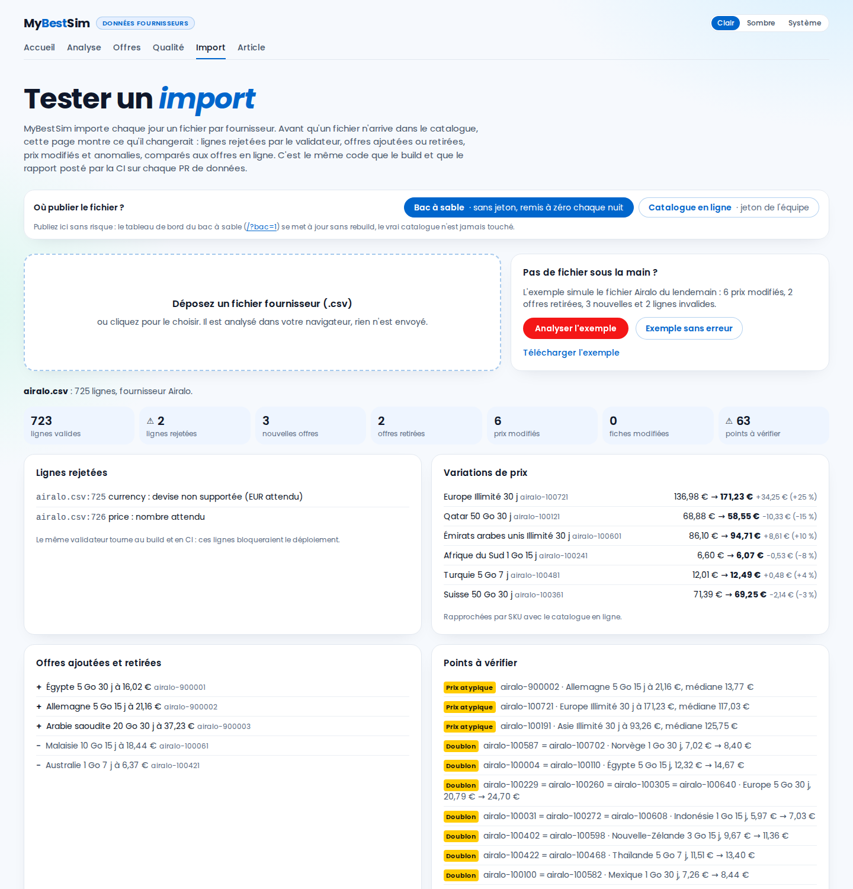

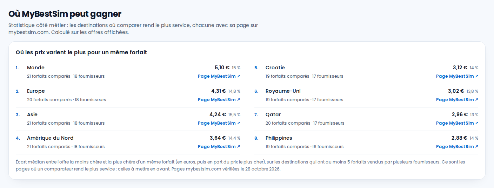

## Architecture

Le site est statique : Astro génère les pages au build, et un îlot React recalcule les chiffres à
chaque filtre. Les données vivent à part, dans un volume tenu par un petit service Bun. Un import
quotidien ne reconstruit donc jamais le site.

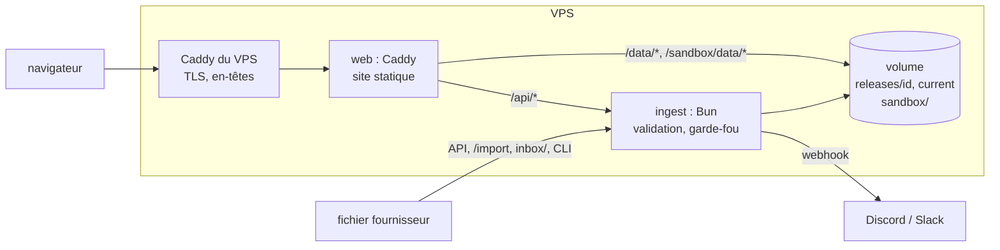

- **`src/lib/`** contient la logique métier, en fonctions pures et testées. Les mêmes modules
  tournent au build, dans le navigateur, dans le service et dans la CI : validation zod, stats,
  filtres, comparaison, contrôles, diff entre imports, garde-fou, rapport.
- **`server/`** est le service d'ingestion. Il valide un import, puis écrit une release complète
  dans un dossier caché et bascule le lien `current` vers elle d'un coup : un lecteur ne voit jamais
  un catalogue à moitié écrit. Il garde l'historique, applique le garde-fou et notifie un webhook.
- **Le front** lit `/data/*.json` (données en direct), ou `/sandbox/data/*.json` avec `?bac=1`.
  Sans service, sur un hébergement statique par exemple, il retombe sur l'instantané du build, sans
  erreur dans la console.
- **Le premier affichage n'attend aucun script.** Chaque page arrive avec ses chiffres rendus au
  build et sa feuille de style intégrée. L'îlot React s'hydrate juste après le premier affichage
  (directive `client:afterpaint`, `src/directives/`). Un Web Worker (`src/workers/`) charge le
  catalogue en direct (1 Mo) et calcule les stats et les contrôles : sur un téléphone moyen, ce
  calcul bloquait la page 200 à 500 ms.

Détail du volume, des variables et du déploiement : [docs/DEPLOY.md](docs/DEPLOY.md).

## Ajouter des données sans rebuild

Quatre chemins, un seul code de validation :

1. **Depuis le site** : sur `/import`, déposer le CSV, vérifier l'aperçu, puis « Publier ». Par
   défaut, la publication va dans le **bac à sable**, sans jeton (voir plus bas). Le vrai catalogue
   demande le jeton de l'équipe.
2. **Par l'API**, par exemple pour une automatisation n8n, Make ou un cron :

   ```sh
   curl -H "Authorization: Bearer $INGEST_TOKEN" -H "Content-Type: text/csv" \
     --data-binary @airalo.csv "https://mybestsim.sbonneau.xyz/api/imports?file=airalo.csv"
   ```

3. **Par dépôt de fichier** dans le dossier `inbox/` du volume (SFTP, rsync). Le service le prend en
   compte en une dizaine de secondes, une fois le fichier stable.
4. **En ligne de commande** : `bun run import --data-dir /data airalo.csv`.

Règles appliquées à chaque import :

- Un fichier invalide est refusé en entier.
- Un fichier remplace les offres du fournisseur qu'il contient.
- Le même fichier renvoyé est marqué « inchangé », sans nouvelle release.
- Le **garde-fou** retient l'import (code 409) quand plus de 20 % des prix d'un fournisseur varient
  de 30 % ou plus, ou quand plus de la moitié de ses offres disparaissent. Un humain peut forcer la
  publication après vérification.
- Le jeton doit faire au moins 24 caractères. Les essais ratés sont limités à 10 par minute et par
  client, les aperçus anonymes à 30.

### Le bac à sable : tester l'automatisation sans jeton

Un recruteur n'a pas le jeton de publication. Pour qu'il puisse quand même tester le parcours
complet, le service tient un second catalogue, **le bac à sable**, dans le même volume mais à part
(`/data/sandbox`) :

- `/import` publie dans le bac à sable par défaut, sans jeton ; l'API est `POST /api/sandbox/imports` ;
- le tableau de bord du bac à sable s'ouvre avec `?bac=1` (lien proposé après la publication), et
  l'encart « Depuis le dernier import » montre ce que le fichier a changé ;
- même traitement que la production : validation, garde-fou, release atomique, sans rebuild ;
- garde-fous propres : 20 publications par heure et par client, aucune notification à l'équipe, et
  **remise à zéro chaque nuit à 3 h** (heure de Paris) sur le jeu de fichiers initial ;
- la production n'est jamais touchée : `checks/verify-sandbox.mjs` le vérifie octet pour octet.

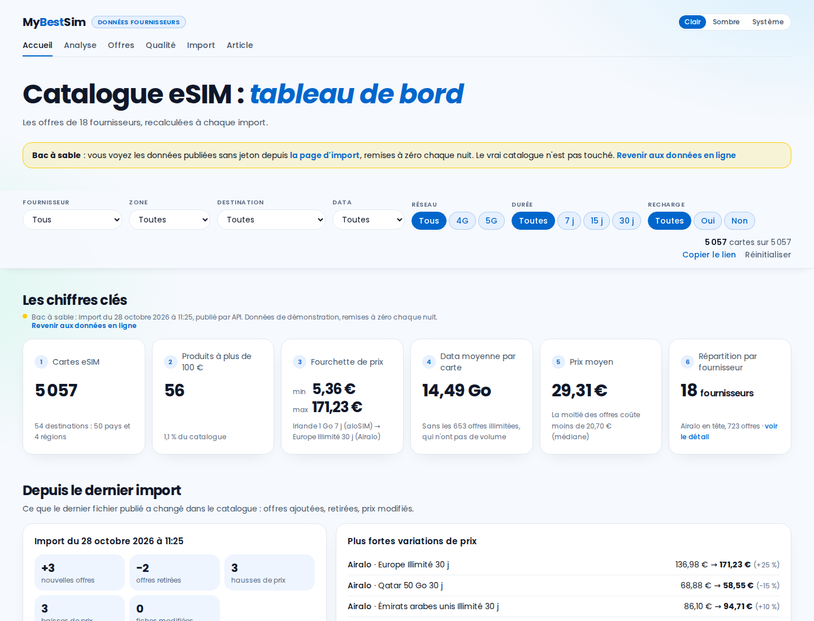

## Choix assumés

Le sujet laisse des questions ouvertes. Je les ai tranchées ainsi, et la page `/qualite` reprend
chaque choix avec sa justification.

- **Les offres « Illimité »** (653, `data_gb` vide) sont exclues de la moyenne de data, et leur
  nombre est affiché à côté. Leur donner une valeur arbitraire fausserait la moyenne.
- **« Plus de 100 € »** s'entend au sens strict. Aucune offre n'est exactement à 100 € (les plus
  proches : 99,39 € et 100,49 €), donc ce choix ne change rien aujourd'hui.
- **EU, AS, NA et WW** sont des forfaits régionaux, pas des pays : AS n'est pas les Samoa
  américaines, NA n'est pas la Namibie. On obtient 54 destinations, dont 50 pays et 4 régions.
- **Les doublons** sont comptés, puisque le sujet demande le nombre de produits du catalogue, mais
  ils sont signalés dans les contrôles.
- **Rien n'est corrigé en silence** : une ligne invalide est rejetée et listée, jamais réparée.
- **Couverture des forfaits régionaux** : les CSV ne la donnent pas. Le simulateur suppose la
  couverture usuelle et l'indique sur chaque résultat.

## Ce que disent les données

- Le prix médian au Go est proche d'un fournisseur à l'autre : de 2,34 €/Go (JamboSIM) à
  2,93 €/Go (4S eSIM).
- L'illimité (51,28 € en médiane) coûte moins cher que le 50 Go (58,75 €).
- La 5G ne coûte pas plus cher que la 4G : sur 795 forfaits vendus dans les deux réseaux, le prix
  médian 5G vaut 100,3 % du prix 4G.
- Les meilleurs prix au Go par destination sont presque tous des offres 50 Go sur 7 jours.
- C'est sur les forfaits régionaux que comparer sert le plus : pour un même forfait Monde,
  Europe, Asie ou Amérique du Nord, l'écart médian entre le moins cher et le plus cher est de
  3,64 à 5,10 €, environ 15 % du prix. Viennent ensuite la Croatie et le Royaume-Uni.

## Partie 2 : l'article SEO

L'article « [Internet en croisière : quelle eSIM choisir ?](https://mybestsim.sbonneau.xyz/blog/internet-croisiere-esim/) »
est une page du même site, rendue au build. La démarche complète est dans
[docs/seo/ANALYSE.md](docs/seo/ANALYSE.md).

- **La longueur vient de la concurrence.** Le sujet ne donne pas de nombre de mots. J'ai relevé les
  pages qui sortent sur les requêtes visées, puis [`scripts/serp-measure.ts`](scripts/serp-measure.ts)
  a mesuré leur HTML : sur 12 pages concurrentes, la médiane est de 2 140 mots et de 9 H2, la moitié
  seulement a un tableau et moins de la moitié une FAQ. L'article fait environ 3 200 mots, avec
  4 tableaux et une FAQ de 7 questions.
- **MyBestSim avait déjà 4 articles sur la croisière.** Un cinquième aurait pu leur prendre leur
  trafic. L'article est donc la page pilier du sujet : il répond à la question générale, puis renvoie
  vers chaque page spécialisée et vers les comparateurs par destination.
- **Ce qui le distingue** : les prix du Wi-Fi par compagnie, le coût du roaming maritime chez les
  opérateurs français, la règle européenne citée à sa source, un conseil par itinéraire avec de vrais
  prix, la croisière fluviale, une checklist et un schéma des zones de connexion.
- **Les prix par itinéraire sont calculés depuis le catalogue** au moment du build, avec le même code
  que le tableau de bord (`src/lib/cruise.ts`). Les autres chiffres sont sourcés et datés.
- **Ton de la marque** : vouvoiement, gras sur l'essentiel, emojis dans les sous-titres et les
  astuces, bouton « Comparer », comme sur la page Thaïlande de MyBestSim.
- **SEO technique** : title et meta description à la bonne longueur, un seul H1, canonical, Open
  Graph, JSON-LD `Article`, `FAQPage` et `BreadcrumbList`, suggestions d'images avec texte
  alternatif.
- **Tout le site est indexable, avec un sitemap.** Le sujet demande un article qui « ranke » : il
  est indexable, listé dans `sitemap.xml` et annoncé par `robots.txt`, comme les pages du tableau de
  bord (une page en `noindex` plafonne à 66 en SEO dans PageSpeed). Seule la page 404 reste hors des
  moteurs. Le jour où MyBestSim publie l'article sur son site, une seule ligne suffit pour éviter le
  contenu dupliqué : une balise canonical vers l'URL de mybestsim.com.

`checks/verify-article.mjs` vérifie à chaque build la longueur, la structure, les balises, la
cohérence du JSON-LD avec la page et chaque prix du catalogue recalculé depuis les CSV.
`checks/verify-article-links.mjs` vérifie que chaque lien externe répond. `checks/verify-seo.mjs`
vérifie chaque page : un seul `<main>` et un seul H1, un title et une description de bonne longueur
et uniques, une canonical égale à sa propre URL, et sa présence dans le sitemap.

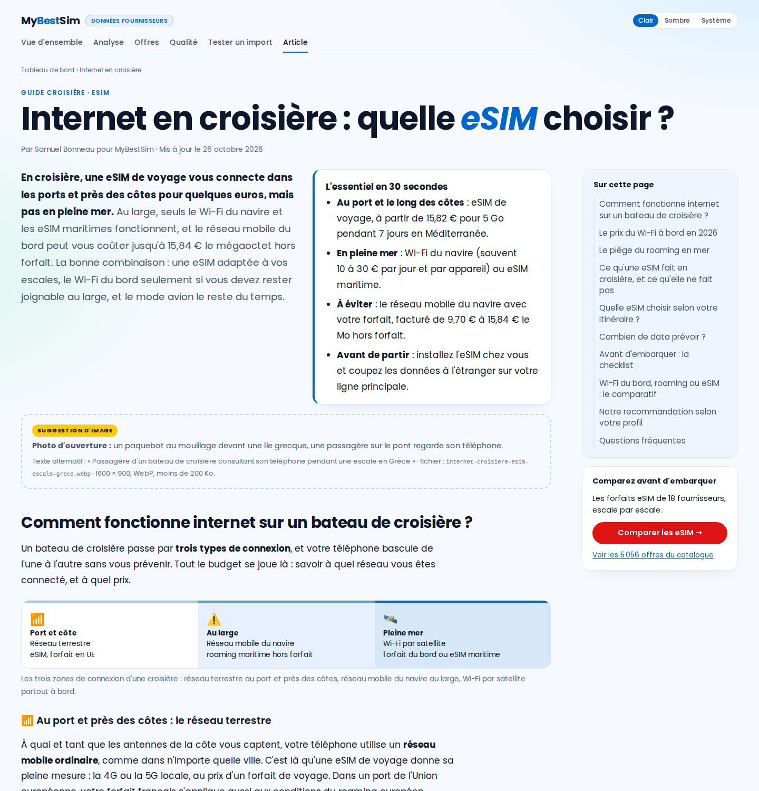

## Qualité et tests

| Niveau | Outil | Ce qui est vérifié |
| --- | --- | --- |
| Schéma | zod (`bun run validate`) | 12 colonnes, types, devise EUR, réseau, cohérence volume et libellé, SKU unique. 0 rejet sur 5 056 lignes |
| Unitaire | `bun test`, 221 tests dans 41 fichiers | chaque module de `src/lib` et du service, avec des chiffres de référence mesurés à part en Python |
| Navigateur | Playwright, 81 tests dans 7 fichiers | KPI sans JavaScript, les six points visibles sans défiler sur téléphone, filtres et URL, histogramme des prix et son infobulle (souris, clavier, tap), logos des fournisseurs, opportunités et liens vers mybestsim.com, tableau, export, simulateur, import puis publication en production et dans le bac à sable, article, aucun scroll horizontal de 360 à 1 440 px, accessibilité axe (WCAG 2.1 AA) en clair et en sombre |
| Oracles | 23 scripts dans `checks/` ([détail](checks/README.md)) | les chiffres affichés sont recalculés depuis les CSV bruts, sans réutiliser le code testé ; la CI en lance 17 à chaque PR (`bun run checks`) |
| Conteneurs | CI | les images web et ingest démarrent ensemble ; publication à travers Caddy, en production et dans le bac à sable ; processus non-root ; données conservées après redémarrage |

Les vérifications sont elles-mêmes vérifiées (contrôles négatifs) :

- un oracle relance le test de débordement mobile sur l'ancienne mise en page, où il doit échouer
  (172 et 202 px de trop à 390 et 360 px) ;
- l'oracle métier, nourri d'un chiffre faussé d'une seule unité, l'a refusé ;
- le validateur Caddy doit rejeter une configuration volontairement cassée ;
- l'oracle de l'article refuse un prix décalé d'un centime et un article absent du sitemap, celui
  des liens refuse une URL inventée ;
- le test axe de `/import` en mode live échoue sur la version d'avant la correction de contraste ;
- l'oracle SEO refuse une page sans `<main>`, une page en `noindex` et une page absente du sitemap,
  et l'oracle PageSpeed refuse une copie du site dont l'accueil est en `noindex` (SEO 66).

### Performance (PageSpeed Insights)

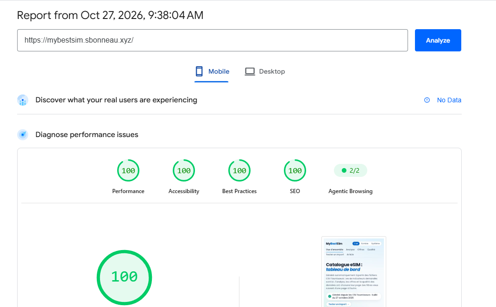

PageSpeed Insights donne 100 dans les quatre catégories à l'accueil sur mobile (analyse du
27 octobre 2026 à 9 h 38, Lighthouse 13.5.0, téléphone émulé en 4G lente). Pour relancer l'analyse :
[pagespeed.web.dev](https://pagespeed.web.dev/report?url=https%3A%2F%2Fmybestsim.sbonneau.xyz%2F).

`bun run checks:live` relance la même version de Lighthouse sur chaque page du site en ligne, trois
fois sur mobile et une fois sur ordinateur. L'oracle (`checks/verify-pagespeed.mjs`) exige 100 en
accessibilité, bonnes pratiques et SEO à chaque passage, et au moins 99 en performance sur
ordinateur. Il affiche le score mobile sans le juger : sur mon portable, une même version obtient de
92 à 100 d'un passage à l'autre, et même l'article, qui n'a pas d'îlot JavaScript, a vu son temps de
blocage passer de 0 à 356 ms. Pour la performance mobile, la référence est PageSpeed Insights, qui
mesure sur les machines de Google.

Avant ces corrections, l'accueil était à 99 sur mobile, 98 en accessibilité et 66 en SEO. Il y avait
quatre causes, chacune corrigée et mesurée (détail dans le tableau des erreurs, plus bas) :

- les pages du tableau de bord étaient en `noindex`, et aucune n'avait de repère `<main>` ;
- chaque page embarquait 480 Ko de données pour l'îlot, ramenées à 50 Ko ;
- le catalogue en direct (1 Mo) était chargé et calculé sur le fil principal, déplacé dans un Web
  Worker ;
- les scripts se téléchargeaient avant le premier affichage, alors que le HTML contient déjà tous les
  chiffres : l'îlot s'hydrate maintenant juste après.

## CI/CD

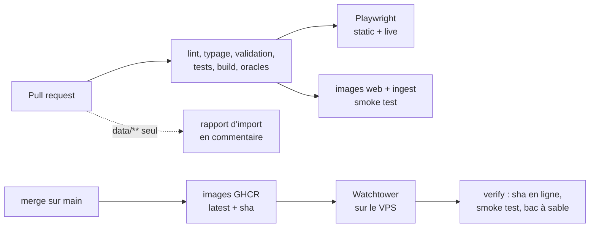

- Le job `check` lance aussi les oracles indépendants de `checks/` après le build.
- Les changements de `data/`, `docs/` et Markdown ne déclenchent pas la CI. Les données passent par
  le service d'ingestion, pas par un build.
- Les tests navigateur et le smoke test des conteneurs tournent sur les PR, pas une seconde fois au
  merge.
- Les tests navigateur tournent dans l'image officielle Playwright, avec Chromium et ses
  bibliothèques déjà installés.
- Dependabot couvre les dépendances bun, les actions GitHub et les images Docker. Deux montées
  se font à la main : TypeScript en version majeure (refusée par `astro check`), et
  `@playwright/test`, qui doit suivre l'image Playwright du job e2e.
- L'historique suit GitHub Flow : une PR par sujet, squash merge une fois la CI verte, et des
  commits au format Conventional Commits.
- Le dépôt a été recréé à la fin de la partie 1, pour un historique propre : chaque commit de
  l'ancien `main` a été rejoué en PR, CI verte à chaque étape, sans les fichiers qui restent en
  local (sujet, archive de données, ledgers).

## Lancer le projet

Prérequis : [Bun](https://bun.sh) 1.4.4.

```sh
bun install
bun run dev          # site seul, http://127.0.0.1:4321
bun run dev:live     # build + service d'ingestion sur un volume jetable, http://127.0.0.1:4322
bun run lint         # Biome
bun run check        # typage (astro check)
bun run validate     # validation des CSV de data/
bun test             # tests unitaires
bun run checks       # oracles indépendants, après un build (--local : Caddy, dataviz, liens de l'article)
bun run checks:live  # le site en ligne, après un déploiement
bun run e2e          # build + Playwright (installer d'abord Chromium : bunx playwright install chromium)
bun run import --data-dir /tmp/vol data/airalo.csv      # import en ligne de commande
bun run screenshots http://127.0.0.1:4322 <jeton>       # régénère les captures de ce README
bun run logos                                          # retélécharge les logos des fournisseurs
bun scripts/serp-measure.ts                            # remesure les pages concurrentes de l'article
```

Avec `dev:live`, le jeton de publication est `dev-token-not-for-production`.

## Structure du dépôt

```text
data/                 CSV fournisseurs de référence (jeu initial du volume)
src/lib/              logique métier pure et testée, partagée partout
src/components/       îlots React et composants Astro
src/directives/       directive d'hydratation client:afterpaint
src/workers/          Web Worker du catalogue en direct
src/pages/            pages (/, /analyse, /offres, /qualite, /import, /blog/…) et endpoints JSON/CSV
server/               service d'ingestion (API, inbox, releases, bac à sable, webhook, sécurité)
scripts/              validation, rapport d'import, CLI d'import, smoke test, captures, logos, mesure SEO
public/logos/         logos des fournisseurs (bun run logos)
e2e/                  tests Playwright
docker/, Dockerfile   images web (Caddy) et ingest (Bun)
deploy/               services Docker Compose et bloc Caddy du VPS
docs/                 déploiement, feuille de route, captures, analyse SEO (docs/seo/)
checks/               oracles indépendants : chiffres, service, CI (voir checks/README.md)
```

## Comment j'ai utilisé l'IA

Le sujet encourage à travailler avec un agent IA. J'ai travaillé avec **Claude Code** (modèle
Claude Opus), dans le terminal sous WSL, sur deux machines. L'agent écrit le code, lance les
commandes, ouvre les pages dans un vrai navigateur et vérifie ce qu'il affirme. Je garde les
décisions et la relecture.

### Méthode : ne jamais croire un « c'est fini » sans preuve

1. **Des critères avant le code.** Pour chaque lot de travail, l'agent écrit d'abord un ledger de
   critères vérifiables (skill [unlazy](https://github.com/Leonxlnx/unlazy)). Chaque critère a une
   commande et un résultat attendu, par exemple « les chiffres affichés correspondent à un
   recalcul indépendant ». Le lot n'est terminé que lorsque tous les critères passent, et ils sont
   tous relancés avant chaque compte rendu. Un hook bloque la fin d'une session tant qu'un
   critère n'est pas rempli. Les ledgers restent sur ma machine ; les oracles qu'ils appellent sont
   versionnés dans [`checks/`](checks/README.md), et la CI les relance à chaque PR.
2. **Des oracles indépendants.** Les chiffres ne sont jamais vérifiés par le code qui les produit.
   Les valeurs de référence ont été mesurées en Python, puis les scripts de `checks/` relisent les CSV bruts avec un parseur volontairement naïf et recalculent tout : KPI, économies,
   contrôles, diff entre imports.
3. **Des contrôles négatifs.** Un test qui ne peut pas échouer ne prouve rien. Le test de
   débordement mobile a donc été lancé sur l'ancienne version, où il échoue comme prévu. L'oracle
   métier a été nourri d'un chiffre faussé, et il l'a refusé.
4. **Une revue visuelle.** À chaque changement d'interface, l'agent prend des captures avec
   Playwright (desktop, 390 px, clair, sombre) et les regarde réellement. La plupart des défauts
   d'affichage ont été trouvés ainsi.
5. **Des skills spécialisés.** `dataviz` valide la palette des graphiques par script (contraste,
   daltonisme) au lieu de la juger à l'œil. `watermarks-remover` passe sur les textes livrés.
   `caveman-commit` impose le format des commits.
6. **Une mémoire hors du dépôt.** Le contexte de travail de l'agent (`CLAUDE.md`), l'état du
   projet, les décisions et leur pourquoi, et le journal des sessions vivent dans mon vault
   Obsidian. Un hook les injecte au démarrage de chaque session : le travail reprend d'une session
   à l'autre sans tout réexpliquer. Le dépôt ne garde qu'un lien symbolique vers `CLAUDE.md`,
   ignoré par git.

### Ce que l'IA a fait, ce que j'ai décidé

L'agent a proposé l'architecture, écrit le code, les tests, la CI et la documentation. Les choix
qui engagent le projet sont les miens :

- reprendre la direction artistique de mybestsim.com ;
- élargir la mise en page, puis découper l'accueil en sous-pages ;
- découpler les données du build, pour ne pas consommer de minutes de CI à chaque import ;
- garder cette architecture plutôt qu'une autre implémentation, détaillée plus bas ;
- recréer le dépôt avec un historique propre, et garder l'URL `mybestsim.sbonneau.xyz` ;
- ouvrir un bac à sable public, pour que le parcours d'import se teste sans jeton ;
- passer l'article en pleine largeur, comme le reste du site ;
- afficher le logo de chaque fournisseur, comme le fait mybestsim.com ;
- relier le tableau de bord à l'activité de MyBestSim (opportunités, liens vers ses pages), parmi
  les idées « métier » proposées par l'agent.

J'ai aussi relevé des défauts que l'agent n'avait pas vus, comme le curseur qui ne se changeait
pas en main sur les boutons, ou l'article enfermé dans une colonne étroite. C'est aussi à ma
demande que l'agent a audité le site en ligne, ce qui a révélé le défaut d'accessibilité de
`/import` décrit plus bas.

**Pour l'article**, l'agent a fait la recherche (moteur de recherche web, lecture des pages
concurrentes et des pages de MyBestSim), écrit l'outil de mesure et rédigé le texte. Il a cherché
puis installé deux skills spécialisés, `seo-audit` et `ai-seo`, dont il a suivi la liste de
contrôle d'une nouvelle page. Chaque chiffre a été relu contre sa source. Une seconde relecture, le
28 octobre, est remontée aux textes officiels : la distance réglementaire des réseaux de bord, d'abord
retirée parce que deux sources disaient 2 ou 4 milles, est en fait de 2 milles en 2G et de 4 milles en
3G, 4G et 5G (décision 2024/340), et l'article la donne maintenant.

### Ce que l'IA a raté, et comment ça a été rattrapé

L'agent se trompe. La méthode sert justement à le voir avant que ça arrive en ligne.

| Erreur | Comment elle a été vue |
| --- | --- |
| Sur téléphone, la page débordait de 202 px | audit initial, par mesure de `scrollWidth`, puis test e2e |
| Le gris secondaire n'atteignait pas le contraste WCAG AA | axe, dans la suite e2e |
| En thème sombre, texte blanc sur un bleu clair illisible | axe |
| Le filtre « Durée » débordait de sa colonne à 360 px | test de débordement |
| Le contrôle « offres incohérentes » recomptait les doublons | revue visuelle des listes, recalcul en Python (553 ramené à 351) |
| Deux imports dans la même milliseconde donnaient des ids non chronologiques | test instable relancé 5 fois, cause trouvée, test dédié |
| Des dossiers temporaires restaient après les tests | vérification de `/tmp` après chaque série |
| Le serveur des tests e2e, arrêté par `SIGKILL`, laissait son volume temporaire dans `/tmp` | contrôle de `/tmp` après une série complète, puis arrêt par `SIGTERM` vérifié par un oracle |
| Un oracle en échec laissait un worktree git derrière lui | `git worktree list` après une ré-vérification |
| En mode statique, trois erreurs 404 dans la console | test e2e « zéro erreur console » |
| Un oracle attendait un mauvais nom de fichier | relecture de l'oracle contre le comportement voulu |
| Le skill de nettoyage de texte déclaré à tort absent | signalé par moi |
| Le curseur restait une flèche sur les boutons | signalé par moi, puis test e2e |
| Les listes déroulantes s'ouvraient en rectangle, hors de la direction artistique arrondie | signalé par moi, puis sélecteur personnalisable dans Chrome et Edge et test e2e |
| Le service non-root ne pouvait pas écrire dans un volume Docker neuf, qui appartient à root | premier passage du smoke test des conteneurs en CI |
| L'installation de Chromium sur le runner prenait 14 minutes, et le job e2e dépassait sa limite | premier passage de la CI, puis passage à l'image Playwright |
| Un test axe était instable : il mesurait le contraste pendant la transition de thème | CI d'une PR Dependabot, sans rapport avec la montée de versions |
| La configuration Dependabot laissait passer TypeScript 7 et une version de Playwright différente de l'image de la CI | CI rouge sur les premières PR Dependabot |
| Dans l'article, le compilateur Astro collait des mots aux liens (« européenYour Europe ») | revue des captures, puis règle ajoutée à l'oracle de l'article |
| Le canonical de l'article n'avait pas la même URL dans la page et dans le JSON-LD | oracle de l'article |
| Deux sources de l'article refusaient les robots ou répondaient une fois sur deux | oracle des liens, sources remplacées par les communiqués officiels |
| Quelques phrases de l'article affirmaient sans source (« la plupart des navires », un volume de data) | relecture phrase par phrase, reformulées ou retirées |
| Sur `/import`, le choix du bac à sable avait un texte à 4,46:1 de contraste et un lien non souligné, invisibles pour la CI : le test axe tournait sans service d'ingestion, donc sans ce choix | audit axe du site en ligne, puis correction et test axe ajouté en mode live |
| En mode statique, la page d'import interrogeait une API absente et laissait une erreur 404 dans la console | test e2e « zéro erreur console », puis fichier témoin servi au build |
| Le bac à sable n'était signalé que par une petite ligne sous les indicateurs | revue des captures, bandeau ajouté en haut de page |
| Le titre de l'article sautait au chargement de la police (décalage de mise en page 0,40), et la page `/import` aussi, quand le choix du bac à sable apparaissait | audit Lighthouse du site en ligne, puis polices préchargées et choix rendu dès le serveur |
| Chaque clic sur « Offres » ou « Analyse » passait par une redirection vers `/offres/` (200 à 760 ms) | audit Lighthouse, puis `try_files` dans le Caddy de l'image |
| La validation zod tentait un `eval`, bloqué par la CSP, ce qui laissait un signalement dans la console de Chrome | audit Lighthouse, puis le mode `jitless` de zod |
| Le nom lu par les lecteurs d'écran pour le logo ne contenait pas son texte visible, et `/import` sautait du titre H1 au H3 | audit Lighthouse, puis corrigés |
| Aucune page n'avait de repère `<main>` pour les lecteurs d'écran | PageSpeed Insights (Lighthouse 13), puis oracle SEO sur chaque page |
| Chaque page du tableau de bord embarquait 480 Ko de données pour l'îlot, dont 300 Ko de contrôles qu'elle n'affichait pas | audit PageSpeed, puis un résumé des contrôles de quelques Ko |
| Sur mobile, le chargement du catalogue en direct bloquait la page 200 à 500 ms | mesure Lighthouse avec et sans ce chargement (TBT de 0 à 44 ms sans lui), puis calcul dans un Web Worker |
| Les scripts de l'îlot se téléchargeaient avant le premier affichage, qui n'en a pas besoin, et retardaient le plus grand élément de la page | audit PageSpeed, puis hydratation après le premier affichage ; un premier essai avec `requestAnimationFrame` partait trop tôt, avant que l'image soit à l'écran |
| Sur `/qualite`, la phrase d'introduction changeait à l'arrivée des données en direct et décalait la page (0,10) | audit PageSpeed, puis une phrase identique dans les deux cas |
| Le sommaire de l'article lisait la position des titres pendant le chargement, ce qui forçait la mise en page de tout l'article avant le premier affichage (107 ms) | oracle Lighthouse en ligne (98 sur mobile), puis lecture déplacée après le premier affichage |
| Sur téléphone, le premier écran de l'accueil ne montrait que deux des six points du sujet : le titre, un paragraphe et sept filtres passaient avant | revue de l'accueil à ma demande, puis un oracle qui mesure la position de chaque point, lancé d'abord sur l'ancienne version, où il échoue |
| L'accueil parlait du test plutôt qu'au lecteur (« les cinq premiers indicateurs demandés », « rebuild », « jeu initial ») et annonçait « 578 points à vérifier » sans les expliquer | même revue ; textes réécrits, la carte qualité commence par le nombre de lignes rejetées |
| L'article attribuait à JeChange le coût de 100 Mo (970 à 1 584 €), alors que c'est notre calcul à partir de ses tarifs | seconde relecture de chaque chiffre contre sa source |
| Le plafond de 50 € était cité depuis Your Europe, qui n'en parle pas pour les bateaux ; la vraie source est le règlement (UE) 2022/612, qui prévoit aussi une exception | même relecture, avec le texte du règlement |
| L'exemple MSC multipliait le prix par jour par 7 pour « une croisière de 7 nuits », qui compte souvent 8 jours | même relecture |
| Les premiers logos d'Airalo, de Maya Mobile et d'Ubigi étaient des logotypes illisibles à 20 px, et celui trouvé pour Truphone était celui de 1GLOBAL | planche d'aperçu avant intégration ; icônes officielles à la place, initiale pour Truphone |
| Avec les logos, la première ligne du simulateur coupait « 15 j » et cachait le badge « Meilleur prix » sur téléphone | captures du lot suivant ; la ligne passe à la ligne entre ses parties, jamais au milieu |
| Le premier classement des opportunités mesurait l'économie par rapport au prix médian : 0,6 à 2,1 €, trop peu pour départager les destinations | l'écart entre le moins cher et le plus cher, déjà utilisé ailleurs sur le site, sépare mieux les destinations |
| L'agent a conclu que la Thaïlande, le Maroc et le Royaume-Uni n'avaient pas de page sur mybestsim.com, parce que leur adresse `comparaison-meilleure-carte-esim-…` répondait 410, et l'a affiché dans le tableau de bord | relecture de véracité demandée avant la PR : le sitemap de mybestsim.com liste leurs pages sous `meilleure-carte-esim-…` (200) ; le panneau a été retiré avant tout commit, et l'oracle vérifie maintenant chaque adresse dans le sitemap |

**Deux implémentations du même besoin.** Une session de travail sur l'autre machine avait ouvert une
PR d'import en SSR avec SQLite, pendant que celle-ci construisait la version actuelle. L'agent l'a repérée avant de
pousser quoi que ce soit, a comparé les deux et m'a laissé trancher. J'ai gardé l'architecture
statique, plus simple à héberger, et repris de l'autre PR ses meilleures idées : limitation des
essais de jeton, imports « inchangés », CLI et smoke test des conteneurs.

### Ce que j'en retiens

L'IA va très vite pour produire, mais elle affirme aussi vite. Le gain vient de ce qui l'entoure :
des critères écrits avant le code, des vérifications qui ne dépendent pas d'elle, et des captures
qu'on regarde vraiment. Chaque chiffre de ce README provient d'un script, pas d'une estimation.

## Limites et suite

- **Couverture des forfaits régionaux** : c'est une hypothèse, faute de donnée dans les CSV.
- **Pages mybestsim.com** : la table des adresses date du 28 octobre 2026. Si MyBestSim déplace une
  page, il faut la mettre à jour ; une destination inconnue de la table n'a simplement pas de lien.
- **Article SEO** : publié ici et indexable ; s'il passe sur mybestsim.com, ajouter une canonical
  vers sa nouvelle URL.
- Le détail des étapes restantes est dans [docs/ROADMAP.md](docs/ROADMAP.md).
