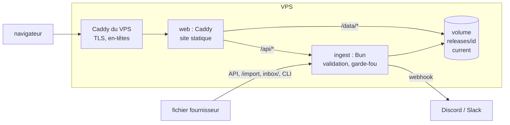
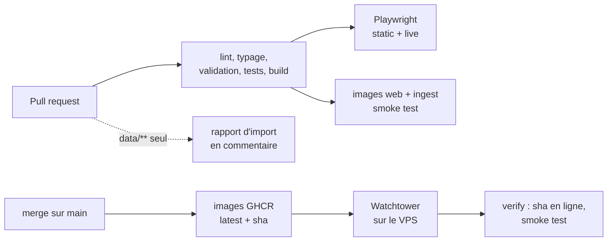

# MyBestSim : tableau de bord du catalogue eSIM

Réponse au test de recrutement « Stagiaire Développeur IA & Automatisation » de MyBestSim.
Le projet lit les fichiers CSV des fournisseurs eSIM et en tire un tableau de bord en ligne.
Il ajoute un service qui importe les fichiers du jour sans reconstruire le site.

- **Dashboard en ligne** : <https://mybestsim.sbonneau.xyz> (déploiement en cours)
- **Article SEO (partie 2)** : à venir
- **Code** : ce dépôt


## Sommaire

- [Ce que demande le sujet, et où le trouver](#ce-que-demande-le-sujet-et-où-le-trouver)
- [Les pages](#les-pages)
- [Au-delà du sujet](#au-delà-du-sujet)
- [Architecture](#architecture)
- [Ajouter des données sans rebuild](#ajouter-des-données-sans-rebuild)
- [Choix assumés](#choix-assumés)
- [Ce que disent les données](#ce-que-disent-les-données)
- [Qualité et tests](#qualité-et-tests)
- [CI/CD](#cicd)
- [Lancer le projet](#lancer-le-projet)
- [Structure du dépôt](#structure-du-dépôt)
- [Comment j'ai utilisé l'IA](#comment-jai-utilisé-lia)
- [Limites et suite](#limites-et-suite)

## Ce que demande le sujet, et où le trouver

| Point du sujet | Valeur | Où |
| --- | --- | --- |
| 1. Nombre total de cartes eSIM | 5 056 | accueil, carte 1 |
| 2. Produits à plus de 100 € | 56 | accueil, carte 2 |
| 3. Fourchette de prix | 5,36 € à 154,63 € | accueil, carte 3 |
| 4. Data moyenne par carte | 14,49 Go (hors 653 offres illimitées) | accueil, carte 4 |
| 5. Prix moyen global | 29,30 € (médiane 20,70 €) | accueil, carte 5 |
| 6. Répartition par fournisseur | 18 fournisseurs, d'Airalo (722) à 4S eSIM (92) | accueil, section 6 |
| 7. Statistiques bonus | prix au Go, paliers, distribution, économies, qualité | `/analyse`, `/qualite` |

Les six indicateurs sont dans le HTML généré au build : la page les affiche avant même que le
JavaScript se charge. Chaque chiffre porte `data-kpi` et `data-value`, pour qu'un programme
puisse le vérifier sans interpréter du texte. Tous ces chiffres ont été mesurés une seconde fois
par un script indépendant, voir [Qualité et tests](#qualité-et-tests).

## Les pages

| Page | Contenu |
| --- | --- |
| `/` Vue d'ensemble | points 1 à 6, constats « À retenir », dernier import, accès aux sous-pages |
| `/analyse` | point 7 : prix médian au Go, prix par palier, histogramme, profil des offres, couverture, meilleures offres, économies |
| `/offres` | toutes les offres (tri, recherche sans accents, export CSV) et simulateur de voyage |
| `/qualite` | contrôle des imports, contrôles métier, choix assumés |
| `/import` | aperçu d'un fichier fournisseur, puis publication |

Les filtres (fournisseur, zone, destination, data, réseau, durée, recharge) vivent dans l'URL : un
lien partagé rouvre la même vue, et la sélection suit le visiteur d'une page à l'autre.

| Analyse | Offres et simulateur |
| --- | --- |
|  |  |

| Qualité | Mobile | Thème sombre |
| --- | --- | --- |
|  |  |  |

## Au-delà du sujet

- **Constats « À retenir »**, calculés sur la sélection en cours. Chacun n'apparaît que si les
  données le justifient.
- **Économies.** Un forfait, c'est une destination, un volume et une durée. Sur 1 113 forfaits,
  1 033 sont vendus par au moins deux fournisseurs. Le plus gros écart est de 60,37 € (Europe
  illimité 30 jours : 94,26 € chez Ubigi, 154,63 € chez aloSIM).
- **Offres imbattables.** Une offre est battue quand une autre, à la même destination, coûte moins
  cher et donne au moins autant (data, durée, réseau, recharge). Seules 1 836 offres sur 5 056 ne le
  sont pas.
- **Simulateur « Quelle eSIM pour mon voyage ? »**, qui tient compte des forfaits régionaux
  (Europe, Asie, Amérique du Nord, Monde) et peut estimer la data à partir de l'usage.
- **Contrôles métier**, qui ne bloquent pas mais signalent :
  - 219 produits identiques vendus sous plusieurs SKU par un même fournisseur ;
  - 8 prix atypiques ;
  - 351 offres incohérentes dans la gamme de leur propre fournisseur.
- **Page `/import`** : un fichier déposé est validé et comparé au catalogue en ligne dans le
  navigateur (lignes rejetées, offres ajoutées ou retirées, prix modifiés), puis publié.
- **Identité MyBestSim** relevée sur mybestsim.com : police Poppins hébergée sur le site, bleu
  `#007bff`, filtres en pastilles, cartes arrondies, bouton principal rouge. Thème clair par
  défaut, sombre bleu nuit en option.


## Architecture

Le site est statique : Astro génère les pages au build, et un îlot React recalcule les chiffres à
chaque filtre. Les données vivent à part, dans un volume tenu par un petit service Bun. Un import
quotidien ne reconstruit donc jamais le site.



- **`src/lib/`** contient la logique métier, en fonctions pures et testées. Les mêmes modules
  tournent au build, dans le navigateur, dans le service et dans la CI : validation zod, stats,
  filtres, comparaison, contrôles, diff entre imports, garde-fou, rapport.
- **`server/`** est le service d'ingestion. Il valide un import, puis écrit une release complète
  dans un dossier caché et bascule le lien `current` vers elle d'un coup : un lecteur ne voit jamais
  un catalogue à moitié écrit. Il garde l'historique, applique le garde-fou et notifie un webhook.
- **Le front** lit `/data/*.json` (données en direct). Sans service, sur un hébergement statique par
  exemple, il retombe sur l'instantané du build, sans erreur dans la console.

Détail du volume, des variables et du déploiement : [docs/DEPLOY.md](docs/DEPLOY.md).

## Ajouter des données sans rebuild

Quatre chemins, un seul code de validation :

1. **Depuis le site** : sur `/import`, déposer le CSV, vérifier l'aperçu, saisir le jeton, puis
   « Publier ».
2. **Par l'API**, par exemple pour une automatisation n8n, Make ou un cron :

   ```sh
   curl -H "Authorization: Bearer $INGEST_TOKEN" -H "Content-Type: text/csv" \
     --data-binary @airalo.csv "https://mybestsim.sbonneau.xyz/api/imports?file=airalo.csv"
   ```

3. **Par dépôt de fichier** dans le dossier `inbox/` du volume (SFTP, rsync). Le service le prend en
   compte en une dizaine de secondes, une fois le fichier stable.
4. **En ligne de commande** : `bun run import --data-dir /data airalo.csv`.

Règles appliquées à chaque import :

- Un fichier invalide est refusé en entier.
- Un fichier remplace les offres du fournisseur qu'il contient.
- Le même fichier renvoyé est marqué « inchangé », sans nouvelle release.
- Le **garde-fou** retient l'import (code 409) quand plus de 20 % des prix d'un fournisseur varient
  de 30 % ou plus, ou quand plus de la moitié de ses offres disparaissent. Un humain peut forcer la
  publication après vérification.
- Le jeton doit faire au moins 24 caractères. Les essais ratés sont limités à 10 par minute et par
  client, les aperçus anonymes à 30.

## Choix assumés

Le sujet laisse des questions ouvertes. Je les ai tranchées ainsi, et la page `/qualite` reprend
chaque choix avec sa justification.

- **Les offres « Illimité »** (653, `data_gb` vide) sont exclues de la moyenne de data, et leur
  nombre est affiché à côté. Leur donner une valeur arbitraire fausserait la moyenne.
- **« Plus de 100 € »** s'entend au sens strict. Aucune offre n'est exactement à 100 € (les plus
  proches : 99,39 € et 100,49 €), donc ce choix ne change rien aujourd'hui.
- **EU, AS, NA et WW** sont des forfaits régionaux, pas des pays : AS n'est pas les Samoa
  américaines, NA n'est pas la Namibie. On obtient 54 destinations, dont 50 pays et 4 régions.
- **Les doublons** sont comptés, puisque le sujet demande le nombre de produits du catalogue, mais
  ils sont signalés dans les contrôles.
- **Rien n'est corrigé en silence** : une ligne invalide est rejetée et listée, jamais réparée.
- **Couverture des forfaits régionaux** : les CSV ne la donnent pas. Le simulateur suppose la
  couverture usuelle et l'indique sur chaque résultat.

## Ce que disent les données

- Le prix médian au Go est proche d'un fournisseur à l'autre : de 2,34 €/Go (JamboSIM) à
  2,93 €/Go (4S eSIM).
- L'illimité (51,28 € en médiane) coûte moins cher que le 50 Go (58,75 €).
- La 5G ne coûte pas plus cher que la 4G : sur 795 forfaits vendus dans les deux réseaux, le prix
  médian 5G vaut 100,3 % du prix 4G.
- Les meilleurs prix au Go par destination sont presque tous des offres 50 Go sur 7 jours.

## Qualité et tests

| Niveau | Outil | Ce qui est vérifié |
| --- | --- | --- |
| Schéma | zod (`bun run validate`) | 12 colonnes, types, devise EUR, réseau, cohérence volume et libellé, SKU unique. 0 rejet sur 5 056 lignes |
| Unitaire | `bun test`, 153 tests dans 29 fichiers | chaque module de `src/lib` et du service, avec des chiffres de référence mesurés à part en Python |
| Navigateur | Playwright, 58 tests dans 6 fichiers | KPI sans JavaScript, filtres et URL, tableau, export, simulateur, import puis publication, aucun scroll horizontal de 360 à 1 440 px, accessibilité axe (WCAG 2.1 AA) en clair et en sombre |
| Oracles | 20 scripts dans `.unlazy/` | les chiffres affichés sont recalculés depuis les CSV bruts, sans réutiliser le code testé |
| Conteneurs | CI | les images web et ingest démarrent ensemble ; publication à travers Caddy ; processus non-root ; données conservées après redémarrage |

Les vérifications sont elles-mêmes vérifiées (contrôles négatifs) :

- un oracle relance le test de débordement mobile sur l'ancienne mise en page, où il doit échouer
  (172 et 202 px de trop à 390 et 360 px) ;
- l'oracle métier, nourri d'un chiffre faussé d'une seule unité, l'a refusé ;
- le validateur Caddy doit rejeter une configuration volontairement cassée.

## CI/CD



- Les changements de `data/`, `docs/` et Markdown ne déclenchent pas la CI. Les données passent par
  le service d'ingestion, pas par un build.
- Les tests navigateur et le smoke test des conteneurs tournent sur les PR, pas une seconde fois au
  merge.
- Les tests navigateur tournent dans l'image officielle Playwright, avec Chromium et ses
  bibliothèques déjà installés.
- Dependabot couvre les dépendances bun, les actions GitHub et les images Docker.
- L'historique suit GitHub Flow : une PR par sujet, squash merge une fois la CI verte, et des
  commits au format Conventional Commits.

## Lancer le projet

Prérequis : [Bun](https://bun.sh) 1.4.4.

```sh
bun install
bun run dev          # site seul, http://127.0.0.1:4321
bun run dev:live     # build + service d'ingestion sur un volume jetable, http://127.0.0.1:4322
bun run lint         # Biome
bun run check        # typage (astro check)
bun run validate     # validation des CSV de data/
bun test             # tests unitaires
bun run e2e          # build + Playwright (installer d'abord Chromium : bunx playwright install chromium)
bun run import --data-dir /tmp/vol data/airalo.csv      # import en ligne de commande
bun run screenshots http://127.0.0.1:4322 <jeton>       # régénère les captures de ce README
```

Avec `dev:live`, le jeton de publication est `dev-token-not-for-production`.

## Structure du dépôt

```text
data/                 CSV fournisseurs de référence (jeu initial du volume)
src/lib/              logique métier pure et testée, partagée partout
src/components/       îlots React et composants Astro
src/pages/            pages (/, /analyse, /offres, /qualite, /import) et endpoints JSON/CSV
server/               service d'ingestion (API, inbox, releases, webhook, sécurité)
scripts/              validation, rapport d'import, CLI d'import, smoke test, captures
e2e/                  tests Playwright
docker/, Dockerfile   images web (Caddy) et ingest (Bun)
deploy/               services Docker Compose pour le VPS
docs/                 déploiement, feuille de route, captures
.unlazy/              ledgers de complétion et oracles indépendants
```

## Comment j'ai utilisé l'IA

Le sujet encourage à travailler avec un agent IA. J'ai travaillé avec **Claude Code** (modèle
Claude Opus), dans le terminal sous WSL, sur deux machines. L'agent écrit le code, lance les
commandes, ouvre les pages dans un vrai navigateur et vérifie ce qu'il affirme. Je garde les
décisions et la relecture.

### Méthode : ne jamais croire un « c'est fini » sans preuve

1. **Des critères avant le code.** Pour chaque lot de travail, l'agent écrit d'abord un ledger de
   critères vérifiables (skill [unlazy](https://github.com/Leonxlnx/unlazy)). Chaque critère a une
   commande et un résultat attendu, par exemple « les chiffres affichés correspondent à un
   recalcul indépendant ». Le lot n'est terminé que lorsque tous les critères passent, et ils sont
   tous relancés avant chaque compte rendu. Il y a 5 ledgers dans `.unlazy/`. Un hook bloque la fin
   d'une session tant qu'un critère n'est pas rempli.
2. **Des oracles indépendants.** Les chiffres ne sont jamais vérifiés par le code qui les produit.
   Les valeurs de référence ont été mesurées en Python, puis les scripts de `.unlazy/*/checks`
   relisent les CSV bruts avec un parseur volontairement naïf et recalculent tout : KPI, économies,
   contrôles, diff entre imports.
3. **Des contrôles négatifs.** Un test qui ne peut pas échouer ne prouve rien. Le test de
   débordement mobile a donc été lancé sur l'ancienne version, où il échoue comme prévu. L'oracle
   métier a été nourri d'un chiffre faussé, et il l'a refusé.
4. **Une revue visuelle.** À chaque changement d'interface, l'agent prend des captures avec
   Playwright (desktop, 390 px, clair, sombre) et les regarde réellement. La plupart des défauts
   d'affichage ont été trouvés ainsi.
5. **Des skills spécialisés.** `dataviz` valide la palette des graphiques par script (contraste,
   daltonisme) au lieu de la juger à l'œil. `watermarks-remover` passe sur les textes livrés.
   `caveman-commit` impose le format des commits.

### Ce que l'IA a fait, ce que j'ai décidé

L'agent a proposé l'architecture, écrit le code, les tests, la CI et la documentation. Les choix
qui engagent le projet sont les miens :

- reprendre la direction artistique de mybestsim.com ;
- élargir la mise en page, puis découper l'accueil en sous-pages ;
- découpler les données du build, pour ne pas consommer de minutes de CI à chaque import ;
- garder cette architecture plutôt qu'une autre implémentation, détaillée plus bas.

J'ai aussi relevé des défauts que l'agent n'avait pas vus, comme le curseur qui ne se changeait
pas en main sur les boutons.

### Ce que l'IA a raté, et comment ça a été rattrapé

L'agent se trompe. La méthode sert justement à le voir avant que ça arrive en ligne.

| Erreur | Comment elle a été vue |
| --- | --- |
| Sur téléphone, la page débordait de 202 px | audit initial, par mesure de `scrollWidth`, puis test e2e |
| Le gris secondaire n'atteignait pas le contraste WCAG AA | axe, dans la suite e2e |
| En thème sombre, texte blanc sur un bleu clair illisible | axe |
| Le filtre « Durée » débordait de sa colonne à 360 px | test de débordement |
| Le contrôle « offres incohérentes » recomptait les doublons | revue visuelle des listes, recalcul en Python (553 ramené à 351) |
| Deux imports dans la même milliseconde donnaient des ids non chronologiques | test instable relancé 5 fois, cause trouvée, test dédié |
| Des dossiers temporaires restaient après les tests | vérification de `/tmp` après chaque série |
| Un oracle en échec laissait un worktree git derrière lui | `git worktree list` après une ré-vérification |
| En mode statique, trois erreurs 404 dans la console | test e2e « zéro erreur console » |
| Un oracle attendait un mauvais nom de fichier | relecture de l'oracle contre le comportement voulu |
| Le skill de nettoyage de texte déclaré à tort absent | signalé par moi |
| Le curseur restait une flèche sur les boutons | signalé par moi, puis test e2e |
| Le service non-root ne pouvait pas écrire dans un volume Docker neuf, qui appartient à root | premier passage du smoke test des conteneurs en CI |
| L'installation de Chromium sur le runner prenait 14 minutes, et le job e2e dépassait sa limite | premier passage de la CI, puis passage à l'image Playwright |

**Deux implémentations du même besoin.** Une session de travail sur l'autre machine avait ouvert une
PR d'import en SSR avec SQLite, pendant que celle-ci construisait la version actuelle. L'agent l'a repérée avant de
pousser quoi que ce soit, a comparé les deux et m'a laissé trancher. J'ai gardé l'architecture
statique, plus simple à héberger, et repris de l'autre PR ses meilleures idées : limitation des
essais de jeton, imports « inchangés », CLI et smoke test des conteneurs.

### Ce que j'en retiens

L'IA va très vite pour produire, mais elle affirme aussi vite. Le gain vient de ce qui l'entoure :
des critères écrits avant le code, des vérifications qui ne dépendent pas d'elle, et des captures
qu'on regarde vraiment. Chaque chiffre de ce README provient d'un script, pas d'une estimation.

## Limites et suite

- **Bac à sable de démonstration** : pour qu'un visiteur puisse publier sans jeton, un jeu
  `sandbox` remis à zéro chaque nuit est prévu.
- **Couverture des forfaits régionaux** : c'est une hypothèse, faute de donnée dans les CSV.
- **Partie 2 du test** : l'article SEO « Internet en croisière : quelle eSIM choisir ? » est à
  venir, avec une analyse de la concurrence.
- Le détail des étapes restantes est dans [docs/ROADMAP.md](docs/ROADMAP.md).
